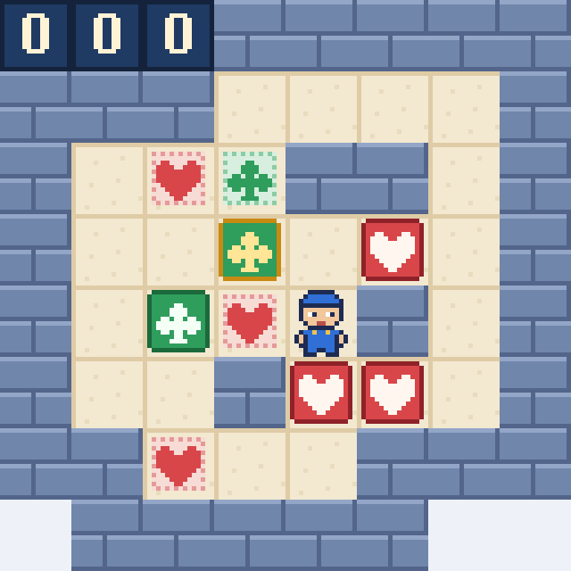

# Corazones y Tréboles

Un puzzle de cajas para un mozo de almacén: tres corazones y dos tréboles, cada uno a una diana de su palo.
Juego web autónomo en **PuzzleScript Next**, con pixel-art 16-bit propio y tarjetas ilustradas con todas las reglas.

**▶ Jugar:** https://spyder-cripto.github.io/corazones-y-treboles/

## Cómo se juega
- **Objetivo:** lleva cada caja a una diana de su palo: corazón con corazón, trébol con trébol.
- **Flechas:** mover · **Z:** deshacer · **R:** reiniciar.
- **En el móvil:** desliza el dedo para moverte; deshacer y reiniciar están en la pestaña del borde izquierdo.
- Se empuja una sola caja cada vez y no se puede tirar de ellas. Una caja en una diana de su palo se vuelve de oro.
- Dentro del juego, el botón **«Cómo se juega»** abre las tarjetas con las reglas y las piezas.

**Récord conocido: 261 pasos**, y es el mínimo: una búsqueda exhaustiva por ordenador de todas las posiciones del
nivel (más de seis millones) no encuentra ninguna solución más corta. ¿Lo igualas?

## Créditos
- Recreación, arte 16-bit y tarjetas: **Spider** (Fali + Claude), 2026
- Nivel original: HansZ («two color 17», sokobanonline.com, 2016)
- Motor: [PuzzleScript Next](https://github.com/david-pfx/PuzzleScriptNext) (derivado de PuzzleScript de increpare), incrustado en un único `index.html`
- Fuente del juego: [`juego.txt`](juego.txt)
